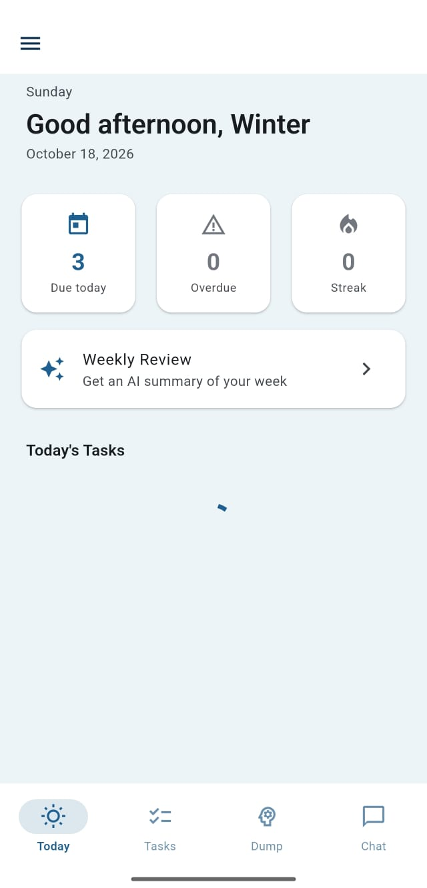
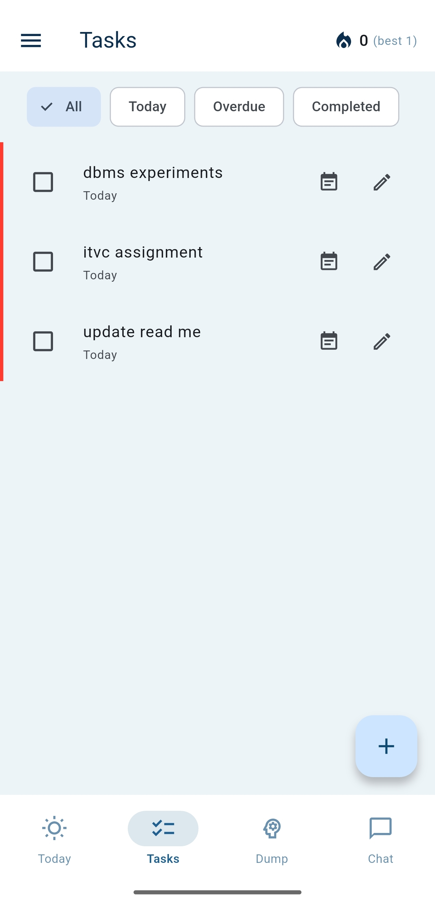
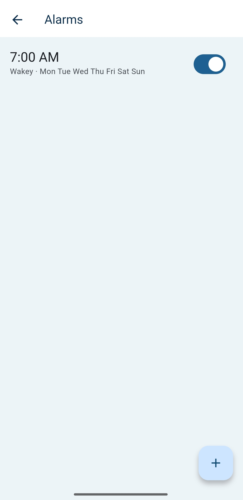
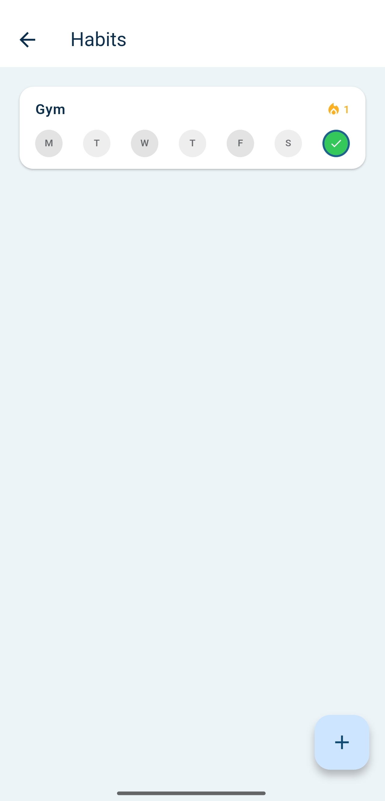
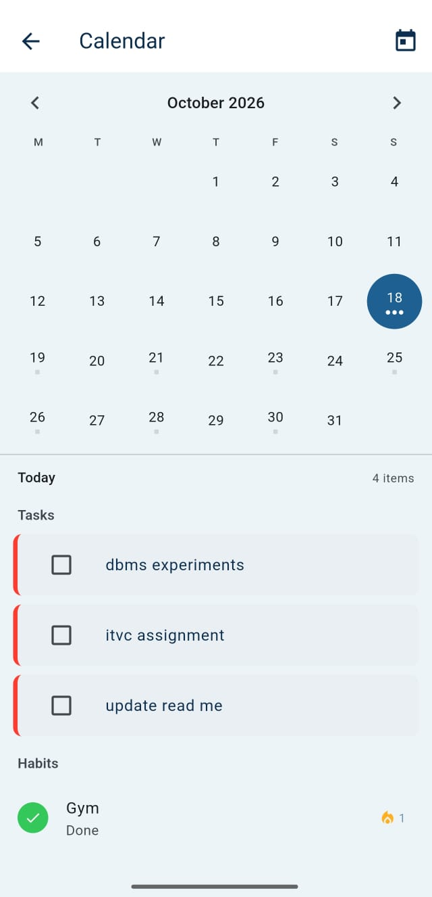
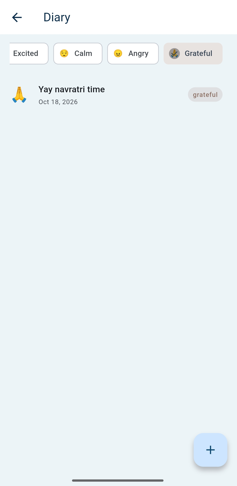
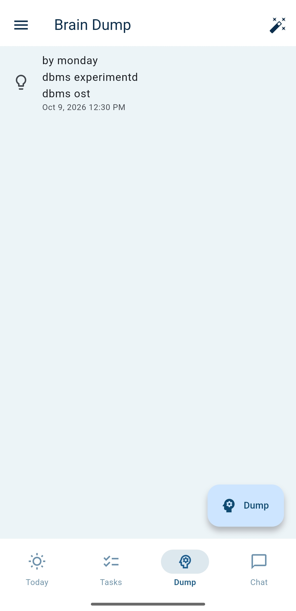
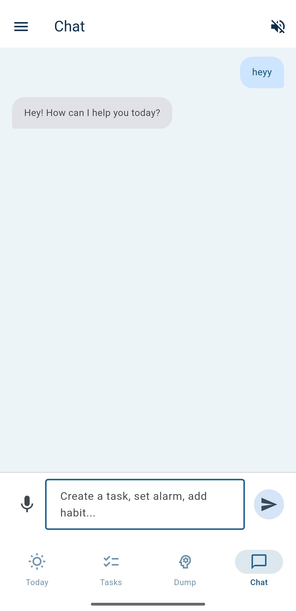
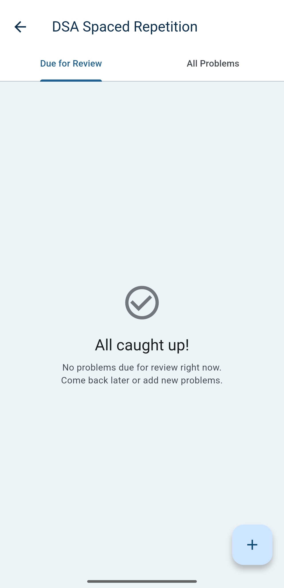
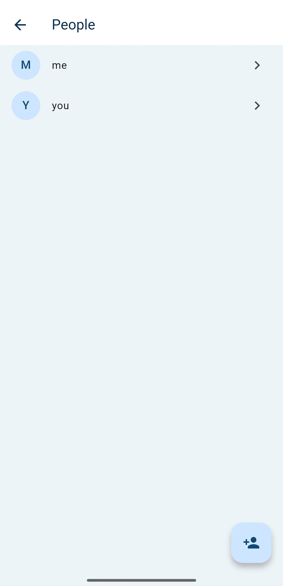

# Personal OS

A mobile-first personal assistant app: tasks, alarms, habits, notes/diary, spaced repetition, and a voice-enabled AI assistant that can actually act on your data — all backed by Firebase with real-time sync. Built with Flutter, targeting Android.

---

## Screenshots

<table>
  <tr>
    <td align="center"><br/><sub><b>Today</b></sub></td>
    <td align="center"><br/><sub><b>Tasks</b></sub></td>
    <td align="center"><br/><sub><b>Alarm ring</b></sub></td>
    <td align="center"><br/><sub><b>Habits</b></sub></td>
  </tr>
  <tr>
    <td align="center"><br/><sub><b>Calendar</b></sub></td>
    <td align="center"><br/><sub><b>Diary</b></sub></td>
    <td align="center"><br/><sub><b>Brain dump + AI sort</b></sub></td>
    <td align="center"><br/><sub><b>AI chat</b></sub></td>
  </tr>
  <tr>
    <td align="center"><br/><sub><b>DSA review</b></sub></td>
    <td align="center"><br/><sub><b>People analysis</b></sub></td>
    <td align="center"><br/><sub><b>Themes</b></sub></td>
  </tr>
</table>

---

## Features

### Tasks & Accountability

- Create, edit, and complete tasks with title, due date, priority (low/medium/high), and notes
- **Subtasks** — break work into steps within a task
- **Tags** — organize tasks by category (custom tag colors)
- **Recurrence** — daily or weekly repeat with weekday selection
- **Escalating reminders** — linked alarm retries at 5min → 15min → 1hr; gives up after the last rung
- **Capped snoozes** — max 3 snoozes per alarm cycle
- **Commitment text** — "Why this matters" shown on the alarm ring screen
- **Completion heatmap** — GitHub-style visual of task streaks
- **Stats screen** — completion rate, streak history, category breakdown

### Alarms

- Create standalone alarms with time, repeat days, and labels
- **Task-linked alarms** — set a reminder directly from the task form
- Real alarms that ring even when the app is closed (via the `alarm` package)
- Frosted-glass ring screen with glow animation, live clock, Stop/Snooze buttons
- Selectable alarm sounds

### Habits

- Track recurring habits (gym, reading, DSA, etc.) with frequency and rest days
- Cycle through statuses: done → skipped → missed → not marked
- **Streak tracking** with fire icon on tiles
- **Completion heatmap** per habit

### Calendar

- Month grid view showing both tasks and habits as colored indicator dots
- Tap a day to see its agenda (tasks first, then habits)
- Mark tasks complete and cycle habit status directly from the calendar

### Diary & Notes

- Create notes with freeform text
- **8 mood tags**: happy, sad, neutral, anxious, excited, calm, angry, grateful
- Filter notes by mood using chip selectors
- Create, edit, delete with swipe-to-delete

### Future Letters

- Write a letter to your future self with a resurface date
- When the date arrives, the app prompts you to write a follow-through reflection
- Letters sorted into Ready / Waiting / Reflected sections

### Brain Dump Inbox

- Zero-friction capture: tap "Dump", type your thought, done
- **Auto-sort with AI** — sends entries to Gemini, which categorizes them into tasks, notes, diary, DSA problems, or people entries
- Review results in a dialog before accepting

### DSA Spaced Repetition

- Add solved DSA problems with optional LeetCode links
- **SM-2 algorithm** (same as Anki): intervals grow at 1 → 3 → 7 → 14 → 30+ days
- Review mode with 4 quality buttons: Again, Hard, Good, Easy
- Due queue shows overdue problems; full list shows all with next review dates

### AI Assistant (Chat)

- Conversational assistant powered by Gemini via the Flask backend, with markdown rendering
- **Acts on your data** via function calling: create tasks, alarms, habits, notes, brain dumps and DSA problems; complete tasks; list tasks, habits, alarms, notes, brain dumps and DSA problems
- **Voice in and out** — speech-to-text input and text-to-speech replies (toggleable)
- Context-aware — maintains conversation history per session
- Bottom-nav tab

### People Analysis

- Keep a profile for people in your life (colleague, family, friend…) and log entries about them (from diary, chat, social, or manual)
- **AI analysis** of the entries into four sections: patterns, red flags, emotional reflection, and communication style
- Written in plain second-person language; says so when there are no red flags rather than inventing them

### Semantic Search

- Search your notes, diary, brain dumps and tasks **by meaning**, not just keywords (e.g. "what did I write about feeling overwhelmed")
- Results ranked by relevance with a short summary of each

### Weekly Review

- AI-written summary of your week on the Today screen, built from your tasks, habit streaks, and mood notes
- Highlights what went well, spots patterns, and suggests one improvement for next week

### Today Screen

- Morning overview with personalized greeting
- Stat cards: due today, overdue, current streak
- Due letters banner when future letters arrive
- Today's task list with square checkboxes matching the Tasks tab
- Weekly review card

### Settings & Profile

- Set your name (stored in Firestore, used for greetings)
- Anonymous guest sign-in with the option to **link a Google account** later
- **4 theme palettes**: Aurora, Midnight Violet, Purple Empire, Warm Amber
- Light / dark / system mode
- **App lock** — 4-digit PIN stored as a salted hash, with a 30-second lockout after 5 failed attempts
- Tag management (create, rename, delete, recolor)
- **In-app updates** — checks GitHub Releases for a newer APK and installs it
- Reset current streak

### Navigation

- **Bottom nav** (4 tabs): Today → Tasks → Dump → Chat
- **Side drawer**: Alarms, Habits, Diary, DSA Spaced Rep, Letters to Future Me, People, Search, Calendar, Stats, Settings

---

## Architecture

```
personal_os/
├── lib/
│   ├── main.dart                    # App entry, Firebase init, global singletons
│   ├── firebase_options.dart        # Firebase config (auto-generated)
│   ├── models/                      # Data models (Firestore ↔ Dart)
│   │   ├── tasks/task.dart
│   │   ├── alarms/alarm.dart
│   │   ├── habits/habit.dart
│   │   ├── notes/note.dart, future_letter.dart, brain_dump.dart
│   │   ├── dsa/dsa_problem.dart
│   │   ├── people/person.dart, person_entry.dart
│   │   └── tags/tag.dart
│   ├── services/                    # Firestore CRUD + business logic
│   │   ├── tasks/task_service.dart
│   │   ├── alarms/alarm_service.dart, alarm_ring_listener.dart
│   │   ├── habits/habit_service.dart
│   │   ├── notes/note_service.dart, future_letter_service.dart, brain_dump_service.dart
│   │   ├── dsa/dsa_problem_service.dart
│   │   ├── people/people_service.dart
│   │   ├── chat/chat_action_handler.dart   # Executes Gemini function calls on Firestore
│   │   ├── api/api_service.dart            # Talks to Flask backend
│   │   ├── api/pinned_http_client.dart     # TLS certificate pinning
│   │   ├── app_lock/app_lock_service.dart  # PIN hashing + lockout
│   │   ├── update/update_service.dart      # GitHub Releases update check
│   │   ├── auth_service.dart
│   │   ├── profile_service.dart
│   │   ├── tags/tag_service.dart
│   │   └── native_bridge.dart              # Android platform channel
│   ├── screens/                     # UI screens
│   │   ├── home_shell.dart          # Bottom nav + drawer
│   │   ├── today/today_screen.dart
│   │   ├── tasks/task_list_page.dart, task_form_screen.dart, task_stats_screen.dart
│   │   ├── alarms/alarm_list_screen.dart, alarm_form_screen.dart, alarm_ring_screen.dart
│   │   ├── habits/habit_list_page.dart
│   │   ├── calendar/calendar_screen.dart
│   │   ├── notes/note_list_page.dart, note_form_screen.dart, brain_dump_page.dart, brain_dump_capture_sheet.dart
│   │   ├── notes/future_letter_list_page.dart, future_letter_form_screen.dart, future_letter_reflect_screen.dart
│   │   ├── dsa/dsa_screen.dart
│   │   ├── chat/chat_screen.dart
│   │   ├── people/people_screen.dart
│   │   ├── search/semantic_search_screen.dart
│   │   ├── app_lock/app_lock_screen.dart
│   │   ├── update/update_dialog.dart
│   │   ├── auth/login_screen.dart, auth_gate.dart
│   │   └── settings/settings_screen.dart, tags/tag_management_screen.dart
│   ├── widgets/                     # Reusable UI components
│   │   ├── tasks/task_tile.dart, day_agenda_tile.dart, subtask_list.dart, tag_section.dart
│   │   ├── tasks/completion_heatmap.dart, completion_history_sheet.dart
│   │   ├── alarms/time_wheel_picker.dart, alarm_ring_widgets.dart
│   │   ├── calendar/month_grid.dart, calendar_widgets.dart
│   │   └── habits/habit_tile.dart
│   ├── theme/app_theme.dart         # 4 palettes, light/dark themes, semantic colors
│   └── utils/                       # Helpers
│       ├── date_utils.dart          # Greeting time-of-day, date formatting
│       ├── sanitizer.dart           # Strips HTML/script/control chars before storing or sending to AI
│       └── task_stats.dart          # Completion rate, streak calculations
│
├── backend/                         # Flask AI backend
│   ├── app.py                       # Flask entry, CORS, health check
│   ├── config.py                    # Environment variable loading
│   ├── firebase_auth.py             # Token verification middleware
│   ├── gemini_client.py             # Gemini wrapper + function-calling tool definitions
│   ├── rate_limit.py                # Flask-Limiter (60/min default, 10/min on AI routes)
│   ├── request_logger.py            # Audit log: method, path, status, user ID
│   ├── routes/
│   │   ├── chat.py                  # POST /api/chat
│   │   ├── auto_sort.py             # POST /api/auto-sort
│   │   ├── analyze_person.py        # POST /api/analyze-person
│   │   ├── semantic_search.py       # POST /api/semantic-search
│   │   └── weekly_review.py         # POST /api/weekly-review
│   ├── requirements.txt
│   └── .env.example
│
├── docs/
│   ├── KEEP_ALIVE.md                # Avoiding Render free-tier cold starts
│   └── screenshots/                 # README screenshots
├── android/                         # Android platform config
├── ios/                             # iOS platform (not primary target)
├── assets/sounds/                   # Alarm sounds
└── pubspec.yaml
```

### Data Flow

```
Flutter App ←→ Firebase Firestore ←→ (real-time sync)
     ↕
Flask Backend ←→ Gemini API (chat, auto-sort, people analysis, search, weekly review)
     ↕
Firebase Auth (ID token verification)
```

- **Firestore** handles everyday data sync (tasks, notes, habits, streaks) — no backend code needed
- **Flask backend** handles anything needing hidden API keys (LLM calls) — keys never ship inside the Flutter app
- **Chat function calling** — Gemini decides which action to take, the backend returns the call, the app runs it against Firestore, then sends the result back for a natural-language reply

---

## Tech Stack

| Layer      | Technology              | Why                                                             |
| ---------- | ----------------------- | --------------------------------------------------------------- |
| Frontend   | Flutter (Dart)          | Single codebase, Android-first                                  |
| Database   | Firebase Firestore      | Real-time sync, offline support, no backend code for basic CRUD |
| Auth       | Firebase Authentication | Anonymous guest, Google sign-in (linkable), email/password      |
| AI Backend | Flask (Python)          | Reuses existing Flask skills, easy to deploy                    |
| LLM        | Google Gemini           | Free tier generous for personal use                             |
| Hosting    | Render (free tier)      | Simple Flask deployment                                         |

### Flutter Dependencies

| Package                                             | Purpose                                  |
| --------------------------------------------------- | ---------------------------------------- |
| `firebase_core`, `cloud_firestore`, `firebase_auth` | Firebase integration                     |
| `google_sign_in`                                    | Google authentication                    |
| `alarm`                                             | Real alarm scheduling                    |
| `wakelock_plus`                                     | Keep screen on during alarm              |
| `audioplayers`                                      | Alarm sounds                             |
| `speech_to_text`, `flutter_tts`                     | Voice input and spoken replies           |
| `http`                                              | Backend API calls                        |
| `flutter_markdown`                                  | Chat message rendering                   |
| `shared_preferences`                                | Local settings cache                     |
| `crypto`                                            | PIN hashing, certificate pinning         |
| `package_info_plus`, `path_provider`, `open_file`   | In-app update download and install       |
| `url_launcher`                                      | Opening links                            |
| `intl`                                              | Date/time formatting                     |
| `file_picker`                                       | File selection (future use)              |

### Backend Dependencies

| Package               | Purpose                            |
| --------------------- | ---------------------------------- |
| `flask`               | Web framework                      |
| `flask-cors`          | Cross-origin requests from Flutter |
| `flask-limiter`       | Rate limiting                      |
| `firebase-admin`      | Token verification                 |
| `google-generativeai` | Gemini API client                  |
| `python-dotenv`       | Environment variable loading       |
| `gunicorn`            | Production WSGI server             |

---

## Setup

### Prerequisites

- Flutter SDK (`C:\flutter\bin` or equivalent)
- Android Studio (for SDK, not as editor)
- VS Code with Flutter + Dart extensions
- Python 3.10+
- A Firebase project (Authentication + Firestore enabled)
- A Gemini API key ([get one here](https://aistudio.google.com/apikey))

### Flutter App

```
# Clone and enter the project
cd personal_os

# Install dependencies
flutter pub get

# Run on connected device
flutter run -d <device-id>

# Build debug APK
flutter build apk --debug
```

### Firebase Setup

1. Create a project at [console.firebase.google.com](https://console.firebase.google.com)
2. Register an Android app, download `google-services.json` → place in `android/app/`
3. Enable Authentication: Anonymous + Google sign-in + Email/Password
4. Create Firestore Database (start in test mode, then deploy security rules)
5. Add SHA-1 fingerprint to Firebase console (for Google sign-in on device)
6. Re-download `google-services.json` after any console change

### Flask Backend

```
cd backend

# Create virtual environment
python -m venv venv
source venv/bin/activate  # or venv\Scripts\activate on Windows

# Install dependencies
pip install -r requirements.txt

# Configure
cp .env.example .env
# Edit .env with your GEMINI_API_KEY and GOOGLE_APPLICATION_CREDENTIALS path

# Run locally
python app.py
# → http://localhost:5000

# Health check
curl http://localhost:5000/api/health
```

### Deploy Backend to Render

1. Push the repo to GitHub
2. Create a new Web Service on [render.com](https://render.com)
3. Settings:
  - **Build command**: `pip install -r requirements.txt`
  - **Start command**: `gunicorn app:app`
  - **Environment**: Python 3.11+
4. Add environment variables:
  - `GEMINI_API_KEY` — your Gemini API key
  - `GOOGLE_APPLICATION_CREDENTIALS` — paste the entire service account JSON contents
5. Deploy — get your URL (e.g., `https://personal-os-backend.onrender.com`)
6. Update `lib/services/api/api_service.dart` with your Render URL
7. If you use certificate pinning, update the pins in `lib/services/api/pinned_http_client.dart` for your host

Render's free tier sleeps after inactivity — see [docs/KEEP_ALIVE.md](docs/KEEP_ALIVE.md) for ways around cold starts.

---

## Commands

```
# Run on phone
flutter run -d <device-id>

# Build debug APK
flutter build apk --debug

# Analyze for issues
dart analyze lib

# Install Flutter dependencies
flutter pub get

# Run Flask backend locally
cd backend && python app.py
```

---

## Project Phases

| Phase                             | Status        | Features                                                                                                          |
| --------------------------------- | ------------- | ----------------------------------------------------------------------------------------------------------------- |
| **Phase 1** — Scheduling + Alarms | ✅ Complete    | Tasks, alarms, escalating reminders, streaks, commitment text                                                     |
| **Phase 2** — Notes + Reflection  | ✅ Complete    | Diary, mood tags, future letters, brain dump, DSA spaced rep, calendar                                            |
| **Phase 3** — Anti-Doom-Scrolling | ❌ Dropped     | Usage-limit interrupts can't be enforced reliably while other apps are open without a background service         |
| **Phase 4** — AI Brain            | ✅ Complete    | Flask backend, Gemini chat with function calling, voice, auto-sort, people analysis, semantic search, weekly review |

---

## Firestore Data Model

All collections scoped to `users/{uid}/` via security rules.

| Collection        | Fields                                                                                                                              | Phase |
| ----------------- | ----------------------------------------------------------------------------------------------------------------------------------- | ----- |
| `tasks`           | title, dueDate, repeatType, repeatDays, priority, subtasks, notes, tagId, completionLog, streakCount, linkedAlarmId, commitmentText | 1     |
| `alarms`          | id, label, hour, minute, type, repeatDays, oneTimeDate, isEnabled, linkedTaskId                                                     | 1     |
| `habits`          | name, frequency, restDays, log, currentStreak                                                                                       | 1     |
| `notes`           | text, mood, createdAt                                                                                                               | 2     |
| `future_letters`  | content, writtenDate, resurfaceDate, reflection, reflected                                                                          | 2     |
| `braindump`       | text, createdAt                                                                                                                     | 2     |
| `dsa_problems`    | name, link, solvedDate, nextReviewDate, intervalDays, easeFactor, reviewCount                                                       | 2     |
| `tags`            | name, color                                                                                                                         | 1     |
| `people`          | name, tags, createdAt                                                                                                               | 4     |
| `people/{id}/entries` | text, sourceType, createdAt, analysis (patterns, redFlags, emotionalReflection, communicationStyle), analyzed                   | 4     |
| `meta/profile`    | name                                                                                                                                | 1     |

---

## Security

- **Firebase Auth** locks every collection — `request.auth.uid == userId` enforced via security rules
- **API keys** live only on the Flask backend (never inside the Flutter app — APKs can be decompiled)
- **Token verification** — every backend request verifies the Firebase ID token before touching data
- **HTTPS with certificate pinning** between app and backend
- **Rate limiting** — 60 requests/min by default, 10/min on AI endpoints
- **Request audit log** — method, path, status, and user ID for every call
- **App lock** — salted-hash PIN with brute-force lockout
- **Input sanitization** on anything stored or sent to the LLM

---

## Free Tier Limits

| Service       | Free Tier                          | Solo Use Reality              |
| ------------- | ---------------------------------- | ----------------------------- |
| Firestore     | 50K reads/day, 20K writes/day, 1GB | Very unlikely to hit          |
| Firebase Auth | Unlimited at this scale            | No concern                    |
| Gemini API    | Rate-limited per minute            | Fine for conversational use   |
| Render        | 750 hrs/month                      | Enough for a personal backend |

---

## License

Personal project, made public for viewing and portfolio purposes. All rights reserved: no license is granted to copy, modify, or redistribute this code. If you'd like to reuse any part of it, please reach out first.